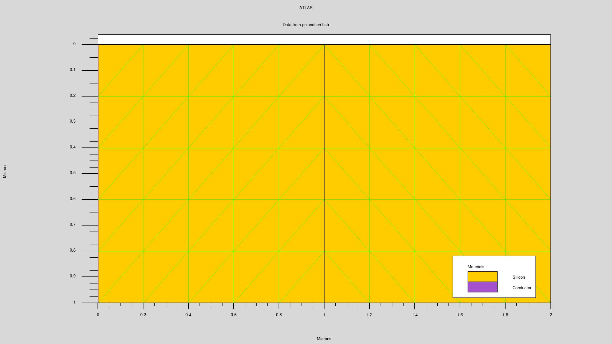

  

# 🦛 HIPPO LAB

### Electronics Engineering | Semiconductor | Embedded Systems

*Exploring the intersection of hardware, software, and semiconductor technology.*

---

## 👋 About Me

Hello! I'm an Electronics Engineering student passionate about
semiconductor devices and embedded systems.

- 🔬 **Semiconductor:** Device Physics, Process Engineering
- ⚡ **Hardware:** RISC-V, FPGA, Computer Architecture
- 💻 **Programming:** C, Python, Verilog
- 🎯 **Goal:** Semiconductor Process & Device Engineering

---

## 🛠️ Tech Stack

### 💻 Programming & HDL

### ⚙️ EDA & Simulation Tools

### 🖥️ Development Environment

---

## 🚀 Featured Projects

### 🔬 MIM Capacitor Research
- Surface roughness and capacitance analysis
- Semiconductor device simulation

### ⚡ RISC-V Processor Labs
- RISC-V Assembly programming
- AXI interface and pipeline analysis

### 🤖 MNIST CNN
- Image classification using PyTorch
- Convolutional neural network implementation

---

## 🔍 Recent Research : PN Junction Diode Simulation

### 1. Overview

This project focuses on the modeling and simulation of a PN junction diode using **Silvaco ATLAS TCAD**.

The objective is to investigate the device structure, doping configuration, and electrical characteristics of a PN junction under different bias conditions.

### 2. Device Structure

The PN junction diode consists of two silicon regions with different doping types.

- **P-type region:** 1 × 10^16 cm^-3
- **N-type region:** 1 × 10^16 cm^-3
- **Device dimensions:** 2 µm × 1 µm
- **Anode:** Left boundary
- **Cathode:** Right boundary

#### 2D Structure and Mesh

*Figure 1. Two-dimensional silicon PN junction structure and computational mesh generated using Silvaco ATLAS.*

The simulation domain is divided into two regions, with the PN junction located at x = 1 µm.

A numerical mesh is generated to discretize the device structure for semiconductor device simulation.

### 3. Simulation Setup

**Simulation Tool:** Silvaco ATLAS TCAD

**Physical Models:**
- Concentration-dependent mobility (CONMOB)
- Boltzmann carrier statistics

**Numerical Method:**
- Newton method

**Temperature:** 300 K

### 4. Electrical Characterization

The electrical behavior of the PN junction diode is investigated by applying different voltage biases to the anode.

The simulation is configured to obtain current-voltage (I-V) characteristics.

### 5. Simulation Results

Additional results, including I-V characteristics and potential distributions, will be documented here.

### 6. Tools

- Silvaco ATLAS
- DeckBuild
- TonyPlot

---

**Keep Learning. Keep Building.**

